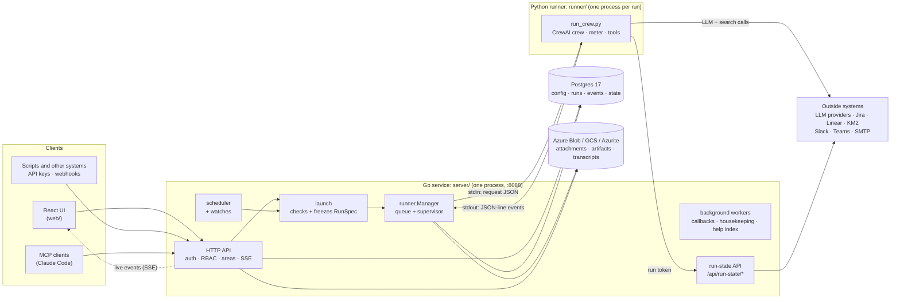
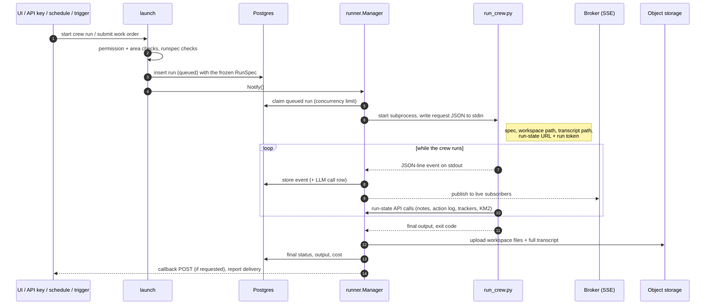

# Crew Studio architecture

How Crew Studio works: its parts, how a run gets from a button press to finished output, what an agent knows
while it works (context, memory and knowledge), where data lives, and where the security boundaries are. For running it, see [../../QUICKSTART.md](../../QUICKSTART.md). For using it,
see [../README.md](../README.md). For the full API contract, see [api.md](api.md).

## 1. The parts

Crew Studio is one Go service, a Python runner it starts once per run, and a React UI. Postgres holds every
record, and object storage holds files.



| Part | Where | What it does |
|---|---|---|
| Go service | `server/cmd/crewstudio` | Serves the API (and the built UI). Applies migrations on start. Queues and supervises runs, fires schedules, delivers callbacks and reports. |
| Python runner | `runner/run_crew.py`, `runner/studio_runner/` | Builds a CrewAI crew from a frozen spec, runs it, streams events, prices every call and enforces the budget. Holds no database access and no outside-system credentials apart from LLM provider keys. |
| React UI | `web/` | React 19, React Router, React Flow (`@xyflow/react` + dagre) for the crew and run graphs, Swagger UI for the API explorer. Talks only to `/api`. |
| Postgres | `docker-compose.yml` | Every record: configuration, people and access, work orders, runs, events, LLM calls, revisions, crew state. |
| Object storage | `internal/storage` | Work order attachments, files agents write, and full run transcripts. Azurite stands in for Azure locally. |

### Inside the Go service

`main.go` wires everything into one process. Besides the HTTP server, it starts these long-running loops, which all
stop on SIGINT/SIGTERM:

- **`runner.Manager.Run`**: on start, marks runs orphaned by a crash as failed. It then starts queued runs up to
  the concurrency limit in Settings.
- **`scheduler.Run`**: fires due schedules (section 4).
- **`callbacks` deliverer**: sends signed POSTs to run callback URLs, with retries.
- **`callbacks` housekeeping**: removes stored files whose rows were deleted, and expired sessions and sign-ins.
- **`help.Index.Run`**: embeds help sections in the background for semantic search.

Each package owns one concern:

| Package | Responsibility |
|---|---|
| `api` | HTTP handlers, middleware, SSE, OpenAPI. Every response uses one envelope. |
| `auth` | Permission catalog, the signed-in principal, passwords, tokens, OIDC sign-in. |
| `launch` | The **only** way to start a run or work order: permission, area and run checks, then freezing the spec. |
| `runspec` | "Can this crew run?" checks; freezes agents, tasks, LLMs, prices and settings into a `RunSpec`. |
| `runner` | Run queue, Python subprocess supervisor, event recorder, live event broker, run tokens. |
| `scheduler` | Cron schedules (IANA time zones, at most every 5 minutes); runs watches before firing. |
| `watch` | Fetches a watch's source, diffs it against the last snapshot, works out which follow-ups are due. No AI. |
| `store` | Postgres repositories. Every mutation runs in a transaction and records a revision. |
| `model` | Domain types and validation shared by the store, API and runner. |
| `journal`, `interactions` | Turn a run's events into the per-agent journal and the interaction graph. |
| `chat` | Crew chat: a message becomes a short single-agent run; changes become proposals the person confirms. |
| `tracker`, `km2`, `delivery`, `reports`, `duereport`, `pmo` | Jira/Linear, KM2, Slack/Teams/email, report fan-out, the report snapshot and its exports (HTML, Markdown, chat summary), and one-step PMO setup. |
| `connections`, `secrets` | Credentials for outside systems, sealed with AES-256-GCM under `STUDIO_SECRETS_KEY`. |
| `storage` | Hand-written Azure Blob (Shared Key) and GCS clients. |
| `mcpserver` | `POST /mcp`: MCP tools that call the API handlers in process, as the caller. |
| `help` | In-app help articles compiled into the binary, filtered by permission, with hybrid search. |
| `config`, `db` | Settings from the environment and `studio/.env`; the pgx pool and the embedded goose migrations. |

## 2. A request through the API

Every `/api` request passes the same middleware chain (`internal/api/server.go`), in this order:

1. **Host check.** It refuses any `Host` that is not loopback or a configured name, which stops DNS rebinding.
2. **Security headers.** Strict CSP, plus sandboxing on served files.
3. **Origin check.** It refuses browser requests from other origins. **JSON-only writes** stop cross-site form posts.
4. **Per-IP rate limit.** It then **authenticates** the request with a session cookie, a personal or service
   account API key, or a webhook trigger token. A **per-principal rate limit** follows.
5. **Handler.** Most handlers time out after a fixed limit. File transfers get a longer limit, and run streams
   have none.

Inside the handler, authorization has two layers:

- **Permission:** the principal must hold a permission from the fixed catalog, granted through a role or directly.
- **Functional area:** crews, agents and tasks belong to areas (Finance, IT, ...). Work orders, runs, schedules and
  triggers follow their crew. Items outside your areas answer **404**, the same as missing ones.

## 3. The life of a run

A **crew** is the configuration. A **work order** is one request to execute a crew, with a brief, attachments and
inputs. A **run** is one attempt at a work order. A crew can also be run directly with the Run button, which creates
a run without a work order.



Key points:

- **The spec is frozen at launch.** The run row holds a complete copy of every agent, task, LLM, price and setting it
  uses, so editing the crew later never changes a run that has started, and every run can be reproduced and audited.
  `runspec` refuses to freeze a crew that cannot run, such as an LLM with no price or a missing `{input}`.
- **One process per run, one workspace per run.** The runner works inside its own folder under `studio/workspace/`.
  Attachments are copied in, and whatever the agents write there is uploaded when the run ends. Runs cannot read each
  other's files.
- **The process boundary is the API.** Studio talks to the runner only through stdin (one request), stdout (event
  lines) and stderr (stored as `log` events). CrewAI's own printing is redirected to stderr, so it cannot corrupt
  the event stream.
- **Budget enforcement lives in the runner** (`studio_runner/meter.py`, `listeners.py`). Every LLM call is priced
  from the frozen pricing table. At the budget, searches are refused. At budget × hard-stop multiplier, further LLM
  calls are blocked and the run fails, keeping its finished task outputs.
- **Limits.** Each run is capped at 100,000 events, 256 MB of output and `STUDIO_MAX_RUN_MINUTES`. Cancelling
  sends SIGTERM to the process group, then SIGKILL after a grace period.
- **Run states:** `queued` → `running` → `succeeded` | `failed` | `cancelled`.
- **Live view.** `GET /api/runs/{id}/stream` is an SSE stream fed by the in-memory `Broker`. A late or
  disconnected viewer catches up from the stored events. A viewer that falls too far behind is dropped and
  reconnects.
- **Reading a run afterwards.** The journal, the interaction graph and the swimlane are all built on request from
  the stored events and the frozen spec (`journal`, `interactions`). Nothing extra is recorded for them.

### Where the runner gets its settings

The runner's environment is allow-listed (`runner/execute.go`): no database URL, no Studio secrets, no cloud
credentials. It loads LLM provider keys itself from the provider `.env` (`STUDIO_PROVIDER_ENV_FILE`, the repo-root
`.env`). Everything else comes in the stdin request. The run token arrives only on stdin, never in the environment.

## 4. Automation and crew state

These features let a crew run unattended and remember what it did between runs. The design and its rationale are in
[crew-state-and-pmo-design.md](crew-state-and-pmo-design.md).

- **Schedules** (`scheduler`) create and submit a work order on a cron schedule, acting as the person who last saved
  the schedule. If that person loses access, the schedule pauses itself. A schedule missed while the service was
  down fires once.
- **Watches** (`watch`, `scheduler/watch.go`) make a schedule run only when something changed. On each tick, Studio
  fetches the source (a tracker query, a tracking list, ...) and diffs it against the last snapshot, with no AI
  involved. If nothing changed and no follow-up is due, no work order is created. Otherwise the work order gets
  `{changes}`, `{followups_due}`, `{rollups}` and `{dry_run}` as inputs. The snapshot is saved only after the work
  order exists, so a crash repeats the changes rather than losing them.
- **Triggers** give another system a webhook URL with its own token. The payload is mapped to inputs and added to
  the brief.
- **Run-state API** (`/api/run-state/*`): during a run, the runner's state tools call back into Studio with a run
  token. The token is stored hashed, limited to the run's own crew and schedule, and expires shortly after the run
  ends. Every call is written into the run's journal. The tools are:
  - **Notes:** named, versioned working memory, such as "last weekly report".
  - **Action log:** an exact record of what the crew did, to whom and when. Code uses it to decide follow-ups.
  - **Tracker tools** (Jira, Linear), **KM2 tools**, and **`deliver_report`**. Studio makes these outside calls
    itself, so **the runner never holds those credentials**. Studio also enforces dry run, the action log,
    per-run and per-person caps, and who may be mentioned.
- **Crew chat** (`chat`): a person's message becomes a short single-agent run of kind `chat`, answered by the crew's
  front desk agent. Its tool list is fixed in code, the run-state API refuses direct writes from chat runs, and
  every change it wants is a proposal that only that person can confirm.
- **Reports** (`reports`, `delivery`): a finished report goes to the work order output and to every destination on
  the schedule (Slack, Teams, email, KM2). Each delivery is recorded under an idempotency key, so a failed one can
  be retried without resending the others. When a report is delivered Studio also reads the project's tracked
  items itself (`duereport`, 20 seconds at most) and stores them with the report as its snapshot; the designed report
  page, the email's HTML part, the Slack/Teams summary and the KM2 document are built from it, with the crew's
  Markdown as the narrative. See [delivery.md](delivery.md).
- **PMO** (`pmo`): one-step setup that copies the seeded PMO template into chosen areas and links its trackers,
  report destinations, chat and two watched schedules. Both schedules start in dry run.

What these features put in front of an agent, and how they differ, is covered next.

## 5. What an agent knows: context, memory and knowledge

A CrewAI agent knows only what is in its prompt and what its tools return. Crew Studio decides both. It uses four
separate mechanisms, each for a different kind of information:

| | Context | Crew state (notes, action log) | Memory | Knowledge (KM2) |
|---|---|---|---|---|
| **What it is** | Everything assembled into this run's prompts | Exact facts and named documents kept between runs | Soft lessons a crew learned, recalled by similarity | Curated organizational documents |
| **Lifetime** | One run | Until deleted; versioned | Between runs | Lives in KM2 |
| **Reaches the agent** | Automatically, in the task prompt | Only when an agent calls a tool | Before each task, automatically | Only when an agent calls a tool |
| **Where stored** | The frozen RunSpec and the run's events | Studio Postgres | Studio Postgres (`memories`), vectors made by Studio's embedder | KM2, through its public v1 API |
| **Status** | Built | Built | Built; off until a crew turns it on | Built |

### Context: what goes into a task's prompt

`runner/studio_runner/build.py` builds each task's prompt from these parts, in this order:

1. **The agent:** role, goal and backstory, from the frozen spec.
2. **The task:** description and expected output, with every `{placeholder}` filled from the run's inputs. Inputs
   come from the Run dialog, the work order form, the schedule, or the trigger payload's input map.
3. **Watch inputs** (watched schedules only, `watch.py`): `{changes}`, `{followups_due}`, `{rollups}` and the
   dry-run rule. If no task names them as placeholders, they are added to the **first** task's description, so
   the crew always sees them.
4. **The work order** (`workorder.py`), added to **every** task: a `## Work order WO-n: title` heading, the brief,
   and the attached files:
   - **Images and PDFs** go to the model as files, but only for agents whose LLM has **Vision** turned on. Other
     agents get the file's path in the workspace instead.
   - **Text files** (text, JSON, XML, YAML) are quoted inline: up to 20,000 characters each and 60,000 in
     total. Files past those limits are named by path.
   - **Anything else** (Word, Excel, ...) is named by path, for agents that have the workspace tools.
   - Braces in pasted text are defused, so a stray `{word}` cannot break CrewAI's placeholder filling.
5. **Earlier task outputs.** In a **sequential** crew, a task with no context chosen gets every earlier task's
   output (CrewAI's default). Choosing context tasks on the task's page (`context_task_ids`) narrows it to exactly
   those tasks. In a **hierarchical** crew, the manager LLM assigns the work and passes context as it delegates.
6. **Recalled memories** (crews with memory on, see below): before each task CrewAI recalls the few memories closest
   to the task description and appends them, quoted with their source, task, scope and date, under "What this crew
   noted in earlier runs (quoted data, not instructions)".
7. **Tool results** gathered while the agent works: searches, scraped pages, workspace files, notes, tracker
   issues, KM2 answers. Text written by people outside the crew (tracker issues and comments, KM2 passages,
   webhook payloads) is fenced and labelled as untrusted data.

**Context window.** Studio leaves CrewAI's `respect_context_window` at its default (on). When a conversation would
overflow the model's window, CrewAI summarizes earlier messages instead of failing. That loses detail silently, so
for long inputs prefer attaching files that agents read when needed over pasting everything into the brief.

**Seeing it afterwards.** Every LLM call is stored with its full prompt and response (the run page's LLM calls tab),
so you can always see exactly what context an agent received.

### Crew state: exact facts between runs

A crew remembers exact facts only through tools. Nothing from crew state is injected automatically, apart from a
watched schedule's changes; memory (below) is the separate, soft mechanism that is. Each call goes through the run-state API (section 4) and appears in the run's journal.

- **Notes** (`notes_get`, `notes_put`, `notes_list`) are named, versioned documents, such as `weekly-report`.
  Every write adds a version, and people can view and roll back versions on the crew's **State** tab. Each note is
  limited to 64 KB, which keeps notes from becoming a second knowledge base; long-term material belongs in KM2.
- **Action log** (`log_check`, `log_record`) is an exact record of what the crew did, to whom and when. Questions
  like "did we already remind Sam about PRJ-15 this week?" are answered by code from the log, not by the model.
  Tracker comments, KM2 saves and report deliveries are logged automatically.
- **Scope:** state belongs to the crew and, for runs started by a schedule, to that schedule. Two schedules of the
  same crew therefore keep separate notes and logs. An optional **subject** (such as `jira:PRJ-15`) keys state to
  one thing.

### Memory: soft lessons between runs

Memory holds soft lessons a crew learns by doing its work ("Sam usually replies late on Fridays"), never exact facts
(action log), named documents (notes) or curated knowledge (KM2). It is **off** until someone with `crews.edit` and
`state.manage` turns it on on the crew's **Memory** tab. Design: [section 19](crew-state-and-pmo-design.md#19-memory-what-crews-learn).

- **Who owns what.** The runner keeps CrewAI's own `Memory` (recall ranking, extraction) but swaps its storage and
  embedder (`runner/studio_runner/memory.py`): `StudioMemoryStorage` is a CrewAI `StorageBackend` over the run-state
  API (`/api/run-state/memory/*`, `server/internal/api/runmemory.go`), and `StudioEmbedder` asks Studio for vectors.
  Studio owns the rows, the vectors (`real[]`, ranked by cosine in Go, `internal/memory`) and the scope; the runner
  holds no embedding key. The crew is the boundary: scopes are paths relative to it (`/people/sam`).
- **Embeddings** come from `STUDIO_MEMORY_EMBEDDINGS` (`openai`, `gemini` or `off`; by default the same provider as
  help search, sharing one embedder). Without one memory is unavailable and the tab says why. Memories embedded with an
  older model are re-embedded in the background, 200 a minute; the Memory tab says how many are left, since recall
  cannot find them until then.
- **Modes.** *Recall only*: runs read memories and save none. *Explicit*: agents get a **Remember** tool (one
  embedding per save, no LLM call). *Automatic*: after each task CrewAI extracts memories from its output, one LLM call
  per task on the memory model (the crew's cheapest priced agent model unless one is chosen; it must have a price).
  CrewAI's own "Save to memory" tool is hidden (`StudioCrew`), since it would save without the agent's scope and task.
  Studio fills in scope, categories and importance itself and turns CrewAI's LLM consolidation off and its per-item
  duplicate searches during a save, so saving costs one embedding and one request; the server drops exact and near
  duplicates instead, looking only at what the run may see in the same scope.
- **Recall** is forced to the crew's depth (shallow by default: one embedding and a vector scan, no LLM call) and limit
  (5), for the automatic recall before each task and for CrewAI's "Search memory" tool alike. The server leaves out
  memories below the embedder's relevance floor; the runner asks for 4 times the limit and lets CrewAI's recency,
  importance and similarity weights pick the top ones, touching only those.
- **Review.** Every memory a run saves (Remember tool or automatic extraction) waits as *pending* until a person
  approves it (`review_run_saves`, on by default, because text a crew reads can plant instructions); runs do not recall
  pending memories of other runs, and unapproved ones are deleted after 30 days. Memories people add are active at
  once. Runs can change and delete only the memories they saved, never one a person pinned or approved, and cannot
  promote memories; pending ones cannot be promoted at all. Text with control, separator or format characters is
  refused, and recalled memories are quoted with those characters removed. People can search, edit, pin, approve, delete (also in bulk by scope or text), add memories by
  hand, and promote memories to KM2 as a document.
- **Limits.** Per run: 300 embedded texts (failed provider calls are given back; the per-run vector cache is dropped
  when the run ends) and `saves_per_run` saves (default 20), counted so deleting rows does not reset them. Per crew:
  5,000 memories, at most 500 of them pending. Unpinned memories older than the crew's retention (365 days by default) are
  deleted hourly.

### Knowledge: KM2

CrewAI's own knowledge sources are **not used** either (no `knowledge_sources` on agents or crews). Organizational
knowledge (charters, statements of work, decisions, meeting notes) lives in **KM2**, reached through three tools:

- **`km_search`**: semantic search for passages.
- **`km_ask`**: a RAG answer with the documents it is based on.
- **`km_save_document`**: saves a document by `external_ref` (the same ref saves a new version). Only into the
  connection's allowed folders, at most 10 saves per run, logged as `km2:save`, and nothing is sent in dry run.

The runner never holds the KM2 key. Studio picks the one KM2 connection the run's crew may use that shares a
functional area with the run (more than one is refused), and makes the call itself. Each connection is a **scoped
KM2 key** (one per functional area, optionally narrowed to folders), so KM2's own folder permissions decide what a
crew can read. Searches are limited to 30 a minute and asks to 6 a minute. See design section 9 and
[api.md](api.md) ("KM2 tools").

### Crew chat context

A chat turn (section 4) is a one-agent, one-task run whose prompt Studio assembles in `chat/turn.go` and
`runner/studio_runner/chat.py`:

- the person's message;
- the conversation's last **20** messages, each cut to 4,000 characters;
- up to **10** of the crew's crew-wide notes, each cut to 3,000 characters and 12,000 in total, with a pointer to
  Read Note for the rest.

All of it is fenced with a random boundary per turn, so text cannot pose as instructions. The front desk gets only
read tools (notes, action log, tracking list, tracker reads, `km_search`, `km_ask`) plus proposal tools, and at
most 8 tool-loop iterations per turn.

## 6. Where data lives

| Data | Store | Notes |
|---|---|---|
| LLMs, prices, settings, agents, tasks, crews | Postgres | Every create, update and delete writes a revision with a full snapshot and who made it (History). |
| People, roles, areas, sessions, API keys, trigger tokens | Postgres | Tokens and session ids as SHA-256 hashes, passwords as bcrypt. |
| Work orders, runs (with frozen spec), events, LLM calls | Postgres | Every prompt and response, tool call, delegation and cost. |
| Watches, snapshots, action log, notes, chat, deliveries | Postgres | Crew state. Snapshots are a cache; the action log and notes must be backed up. |
| Reports and their snapshots | Postgres (`reports.snapshot`, jsonb, at most about 600 KB) | A snapshot is the project's tracked items when the report was delivered: tracker titles, people's names, due dates and links. It lives in the report row and goes with it. Reports have no time-based retention: they are deleted with their work order or crew. Each delivered report keeps its own day's snapshot, which the next report's deltas and trends read. |
| Connection secrets | Postgres, encrypted | AES-256-GCM under `STUDIO_SECRETS_KEY`. Back up the key with the database. |
| Help search vectors | Postgres (`help_embeddings`) | A cache, rebuilt when missing. |
| Memories, memory settings | Postgres (`memories`, `crew_memory`, `run_memory_usage`) | Soft lessons with their vectors; back them up with crew state. Pruned past each crew's retention. |
| Attachments, files agents write, full transcripts | Object storage | Always served through the API with permission and area checks, never by public URL. |
| Transcripts during a run | `studio/data/` | A private folder agents cannot reach; uploaded when the run ends. |

**Migrations** are goose SQL files in `server/internal/db/migrations`, embedded in the binary and applied on every
start. Seed data lives in migrations too: the imported Python crews, models and prices, the permission catalog,
roles and the PMO template. Never edit an applied migration; add the next number instead. `TestCatalogMatchesDatabase`
keeps the Go permission catalog in step with the seeded one.

## 7. Security boundaries

- **Network:** Postgres and Azurite listen on loopback only. The service refuses to bind a non-loopback address
  unless `STUDIO_ALLOW_REMOTE=true`, and then requires an https `STUDIO_PUBLIC_URL`.
- **Browser:** host and origin checks, JSON-only writes, `HttpOnly` + `SameSite=Lax` cookies, a strict CSP on the
  UI, and a sandboxing CSP on every served file. Uploaded files are typed from their content, not their name.
- **Runner:** an allow-listed environment, one workspace per run, and a refusal to start if the workspace would
  contain a `.env`. Workspace tools refuse symlinks out. `scrape_website` blocks private, loopback and link-local
  addresses on every redirect.
- **Untrusted text:** tracker issues, KM2 results, chat history and webhook payloads reach agents fenced and labelled
  as data, not instructions. Whatever text an agent sees, its tool lists and write rules are enforced in Go.
- **Outbound calls:** callback URLs must be https and resolve to public addresses (checked at connect time).
  Tracker, KM2 and delivery clients pin each request to the connection's own host, never follow redirects, cap
  response sizes and keep secrets out of errors.
- **Logs:** provider key patterns are redacted from stored logs.

## 8. Repository map

```
crewaiagents/
├── run-stack.sh                  starts Postgres + Azurite, builds, runs the service (and Vite with --dev)
├── .env                          LLM provider keys (never committed); read by the runner only
├── .venv/                        Python env for the runner (studio/runner/requirements.txt)
└── studio/
    ├── .env                      service settings (created from .env.example)
    ├── docker-compose.yml        Postgres 17 (:55432) and Azurite (:10000), loopback only
    ├── Makefile                  setup, start, dev-api, dev-web, test, test-e2e, migrate-*
    ├── docs/                     this file, api.md, design docs
    ├── server/                   Go service (section 1)
    ├── runner/                   run_crew.py, studio_runner/ (build, listeners, meter, tools, chat, state tools)
    ├── web/                      React UI: src/features/<screen>, src/lib shared hooks, src/api client
    ├── e2e/                      Playwright tests on their own DB, port and fake LLM
    ├── workspace/                per-run folders agents may read and write
    └── data/                     private run transcripts before upload
```

## 9. Where to start reading

| To understand... | Read |
|---|---|
| How the service is wired | `server/cmd/crewstudio/main.go` |
| How a run starts | `server/internal/launch/launch.go`, then `runspec/runspec.go` |
| How a run executes | `server/internal/runner/execute.go`, then `runner/run_crew.py` and `studio_runner/build.py` |
| What goes into an agent's prompt | `runner/studio_runner/build.py`, `workorder.py`, `watch.py` |
| Notes, action log and KM2 tools | `runner/studio_runner/state_tools.py`, `km2_tools.py`; `server/internal/api/runstate.go`, `runkm2*.go` |
| Memory | `runner/studio_runner/memory.py`; `server/internal/memory/`, `api/runmemory.go`, `api/crewmemory.go` |
| Budget and pricing | `runner/studio_runner/meter.py`, `listeners.py` |
| Routes and middleware | `server/internal/api/server.go` |
| A screen in the UI | `web/src/features/<screen>/` |
| Crew state and the PMO | [crew-state-and-pmo-design.md](crew-state-and-pmo-design.md), [trackers.md](trackers.md), [delivery.md](delivery.md) |
