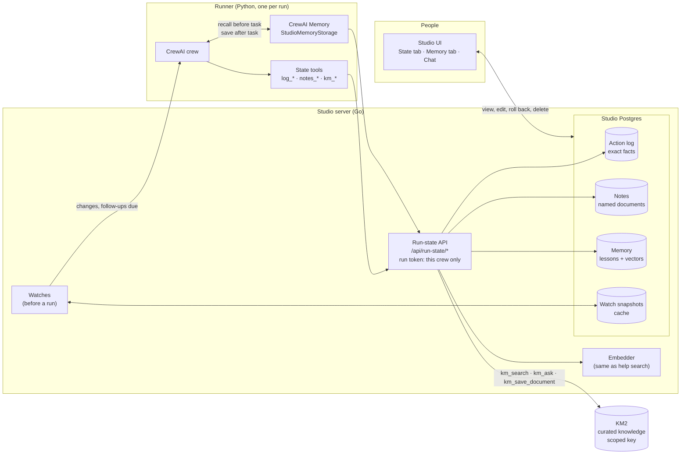
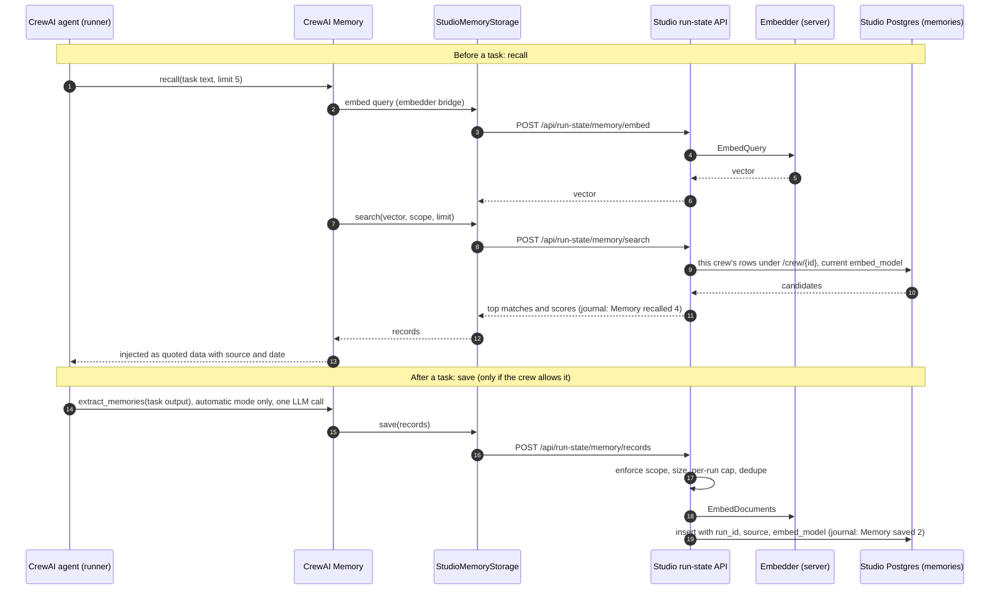

# Crew state and the PMO: design

Status: draft for review · Written 2026-10-05

This document proposes two things:

1. **Crew state.** These are building blocks that let any crew remember what it saw and what it did between
   runs. With them, a crew no longer starts from scratch, and the AI only sees what changed.
2. **The PMO.** This is a Project Management Office crew built on those blocks. It follows up on tasks, due
   dates and owners in Jira or Linear, and writes weekly status reports.

The PMO is the first user of crew state, not a special case. The training, IT, finance and research crews in
the examples below use the same blocks.

---

## 1. Why

Today every Studio run starts from nothing. The runner receives a frozen crew spec and inputs. It keeps no
record of earlier runs, and CrewAI's own memory is turned off.

For one-off work that is fine. For recurring work it is costly and unreliable:

- **Cost.** A daily "check on these projects" crew would read every issue in every project, every day. It
  would also ask the AI to work out what changed. Most days, almost nothing has.
- **Reliability.** "Have we already reminded Sam about this?" is a question the AI should not answer from
  memory. If it guesses wrong, people get nagged twice or never.
- **Continuity.** This week's status report should build on last week's, not be written from scratch.

### CrewAI's built-in memory, and why Studio stores it instead

CrewAI 1.15 (the version installed) has one unified `Memory` class:

- **It costs tokens to save.** Every save is embedded (OpenAI by default) and run through an LLM pass that
  extracts and merges facts.
- **Recall is fuzzy.** It is a similarity search.
- **It is stored in a local LanceDB file on the runner.**

Used as shipped, that is the wrong tool for four reasons:

- It is invisible to people. Nobody can see or fix what it remembered.
- It ignores functional areas and permissions.
- Every write spends tokens.
- Fuzzy recall cannot answer exact questions like "did we remind Sam about PRJ-15 since Oct 3?"

**Decision (revised 2026-10-05): crews get memory, but Studio stores it** (section 19). CrewAI's `Memory` lets
the storage be replaced (`StorageBackend`), so the runner keeps CrewAI's recall and extraction while every
memory lives in Studio's database, scoped to the crew, visible and editable in the crew's Memory tab, and
written only within limits the crew sets. That answers the first three objections. The fourth stays a rule:
memory is for soft lessons ("Sam usually replies on Fridays"), never for exact questions. Those go to the
action log, which is why reminders never depend on memory.

Memory is separate from KM2. KM2 holds curated knowledge people and crews *publish* ("knowing"); Studio memory
holds what a crew *learned* by doing the work ("remembering").

---

## 2. Decisions so far (2026-10-05)

| Topic | Decision |
|---|---|
| Where tasks live | In the team's tracker (Jira or Linear). Studio does **not** get its own task list. |
| Trackers | Jira Cloud and Linear, both behind one tracker interface. |
| How people are reminded | `@mention` comments on the tracker issue. Jira and Linear then send their own email, Slack and Teams notifications. |
| What the PMO may change | Comment and report only. It *suggests* changes to dates, owners and status. A person makes them. Whether it may also write status back onto tracking items is **deferred** until Jira or Linear is connected. |
| How the PMO knows what to track | **People tell it in chat:** "track PRJ-10 and its sub-tasks as Project Atlas". It keeps a tracking list (section 12). |
| Where status comes from | **Roll-ups:** each tracking item's status is rolled up from its child tickets (fields and new comments). |
| Where weekly reports go | The work order output, a Teams or Slack channel, email and KM2. A tracker destination is decided once trackers are connected. |
| What crews learn (memory) | **In Studio**, not KM2: CrewAI's memory with Studio as its storage, scoped per crew, visible and editable (section 19). Revised 2026-10-05; this was previously a non-goal. |
| Curated knowledge | KM2 (Knowledge Manager), through its public API only. Studio stays independent of KM2's code. Studio sends **documents** to KM2. |
| KM2 layout and access | One dedicated KM2 org for Studio (not Corporate Training). Access is controlled by KM2's own folder permissions; each Studio area uses a KM2 key **scoped to dimension assignments and optional folders** (shipped in KM2 2.6.0; section 9). |
| Who decides "what changed" and "who is due a reminder" | Code, not the AI. The AI writes the messages and judges what the changes mean. |

---

## 3. Goals and non-goals

**Goals**

- Any crew can be given: a watch (only run when something changed), an action log (exact record of what it
  did), notes (working memory) and memory (lessons it learned). The PMO is not special.
- Quiet days cost close to nothing. If a watch sees no changes, no run starts.
- Everything a crew remembers can be seen, corrected and reset by an admin.
- State follows functional areas. A Finance crew cannot read HR's notes.
- Losing the snapshot data never breaks anything. It is rebuilt on the next tick.

**Non-goals**

- A task tracker inside Studio.
- Memory as a source of truth. Exact facts belong in the action log, named documents in notes, curated
  knowledge in KM2. Memory only nudges how a crew works.
- Memory that people cannot see. Every memory is listed, editable and deletable in the crew's Memory tab.
- Changing tracker fields automatically (may come later behind an approval queue).
- Messaging people directly for reminders (the tracker does this). Channel and email sending is for reports
  only.

---

## 4. Concepts

### Scope

Every piece of state belongs to a **scope**:

- **crew:** required. State belongs to a crew.
- **schedule:** optional. Two schedules of the same crew (for example "Project Atlas sweep" and "Project
  Birch sweep") keep separate state.
- **subject:** optional. A free-form key for the thing the state is about, such as `jira:PRJ-15`,
  `project:atlas` or `person:sam@example.com`.

A scope takes its functional areas from its crew. Area rules work as they do everywhere else in Studio: you
see state only for crews in your areas.

### The building blocks

| Block | What it is | Rebuildable? | Read by | Written by |
|---|---|---|---|---|
| **Watch** | Fetches a source on a schedule and compares it with the last snapshot | Yes, it is a cache | Studio (before the run) | Studio |
| **Action log** | Exact record of what a crew did, to whom, when | No, keep and back up | Code and agent tools | Agent tools (automatically) |
| **Notes** | Named working memory such as "last weekly report" | No, keep and back up | Agent tools | Agent tools |
| **Memory** | Soft lessons the crew learned, recalled by similarity (section 19) | No, keep and back up (vectors are rebuildable) | CrewAI before each task | CrewAI after each task, within the crew's limits; people in the Memory tab |
| **Knowledge** | Curated organizational knowledge in KM2 | Lives in KM2 | Agent tools | Agent tools |

Plus one way in: **crew chat** (section 8), where people talk to a crew to tell it what to do or ask what it
knows.

### How it fits together



Which store answers which question:

| Question | Store | Why |
|---|---|---|
| "Did we remind Sam about PRJ-15 since Oct 3?" | Action log | Exact; code decides, not the AI |
| "What did last week's report say?" | Notes | A named document, versioned |
| "Does Sam usually reply late on Fridays?" | Memory | A soft lesson, recalled when it seems relevant |
| "What does the Atlas statement of work say?" | KM2 | Curated, shared beyond this crew, permission-checked by KM2 |

---

## 5. Watches: run only when something changed

A watch is attached to a schedule. It has:

- **A source:** a connection plus a query. For example, Jira issues in project PRJ that are not done.
- **The ID field:** what identifies each item (`key` for Jira, `identifier` for Linear, a JSON path for
  others).
- **The fields to track:** such as `status`, `assignee`, `due_date`, `priority` and `updated_at`.
- **Run when:** one of
  - `changed`: default; run only if something changed
  - `always`: run every tick, but still pass the changes
  - `changed_or_followups`: run if something changed *or* a follow-up step is due (see section 6)

### What happens on each tick

1. The scheduler fires the schedule as it does today.
2. If the schedule has a watch, Studio fetches the source. Code compares the result with the stored snapshot,
   with no AI involved.
3. Studio works out which follow-ups are due (section 6).
4. **If there is nothing to do,** no work order is created. The schedule records `last_checked_at` and
   "checked, no changes". Cost: one fetch, zero tokens.
5. **Otherwise,** Studio creates the work order as usual and adds two inputs: `changes` and `followups_due`.
6. The snapshot is saved **only after the work order is created**. A crash in between means the next tick
   sees the same changes again, not that they are lost.

### Change format

```json
{
  "source": "jira:PRJ (open issues)",
  "checked_at": "2026-10-06T07:00:00-06:00",
  "previous_check_at": "2026-10-05T07:00:00-06:00",
  "added":   [{"id": "PRJ-18", "fields": {"status": "To do", "assignee": null, "due_date": "2026-10-20"}}],
  "changed": [{"id": "PRJ-12", "fields": {"due_date": {"old": "2026-10-10", "new": "2026-10-20"}}}],
  "removed": [{"id": "PRJ-9",  "reason": "no longer matches the query"}],
  "new_comments": [{"id": "PRJ-15", "author": "sam", "at": "2026-10-05T16:20:00-06:00",
                    "excerpt": "Blocked on vendor access, expect Thursday."}],
  "unchanged_count": 41
}
```

For tracker sources, a watch can also track **new comments**. Studio stores the newest comment time it has
seen per issue (in the snapshot) and returns only comments after it. Comments are a main input for status:
"blocked on vendor", "will slip a week". Excerpts are capped (default 500 characters each, 50 per tick). The
crew can fetch the full thread with `tracker_get_issue`. Comments written by the PMO's own connection
account are left out, so it does not react to itself.

The first tick has no previous snapshot. Everything counts as `added`, and the crew is told this is the first
check (`previous_check_at: null`), so it can write a baseline report instead of announcing 40 "new" issues.

### Sources

1. **Tracker connections** (Jira, Linear). Needed for the PMO.
2. **JSON over HTTP** from a connection with a base URL and auth.
3. **A web page**, comparing extracted text or a CSS selector, with the same private-network blocking as the
   Scrape Website tool.
4. **A workspace file**, such as a CSV dropped by another process.

Later: database queries and KM2 searches.

### Limits

- Maximum items per watch (default 2,000). Past that, the tick fails with a clear error instead of silently
  cutting the list.
- Long text fields are compared by hash. The change list says "description changed" without the full text,
  and the crew can fetch the issue if it cares.
- Snapshots store only the tracked fields, not whole issues. This keeps personal data and storage small.

---

## 6. Action log and follow-up ladders

### Action log

Each entry is a row: `(scope, subject, action, at, run_id, details)`. Examples:

| subject | action | at | details |
|---|---|---|---|
| `jira:PRJ-15` | `followup:due_soon` | 2026-10-04 07:02 | `{"to": "sam", "comment_url": "…"}` |
| `jira:PRJ-15` | `followup:overdue_escalate` | 2026-10-09 07:01 | `{"to": "dana (lead)"}` |
| `project:atlas` | `report:weekly` | 2026-10-06 08:15 | `{"note": "weekly-report", "channels": ["linear", "teams"]}` |

Agent tools:

- `log_check(subject, action, within?)` returns the latest matching entry, or none.
- `log_record(subject, action, details, idempotency_key?)` adds an entry. Recording the same idempotency key
  twice is a no-op, so a retried tool call does not double-log.

**Tools that act also log for themselves.** When the tracker comment tool posts a follow-up, it writes the log
entry in the same step. The AI cannot "forget" to record a reminder it sent.

### Follow-up ladders

A ladder is a list of rules tied to a date field on each item. It is set on the watch:

```json
{
  "date_field": "due_date",
  "skip_when": {"status": ["Done", "Canceled"]},
  "steps": [
    {"name": "due_soon",          "offset": "-3d", "notify": "owner"},
    {"name": "due_today",         "offset": "0d",  "notify": "owner"},
    {"name": "overdue_escalate",  "offset": "+2d", "notify": "lead"},
    {"name": "overdue_weekly",    "offset": "+9d", "notify": "lead", "repeat": "7d"}
  ],
  "quiet_days": ["Sat", "Sun"],
  "timezone": "America/Denver"
}
```

On each tick, code walks every item and every step:

- A step is **due** when its date has passed, the item isn't skipped, and the action log has no entry for
  `(item, followup:<step>)`. For repeating steps, it is due if there is no entry within the repeat period.
- Due steps go to the crew as `followups_due`, with the item, step and who to notify.
- The crew writes the message, in the right tone for a first nudge or an escalation, and posts it with the
  tracker tool. Posting also logs it.

A due date that moves is handled for free: offsets are worked out from the current date each tick.

Who counts as "owner" and "lead" comes from people mapping (section 10).

---

## 7. Notes: working memory

Named text or JSON documents per scope, for example:

- `weekly-report` for project Atlas: last week's report, so this week's covers only what changed.
- `risk-register` for project Atlas: risks the PMO is tracking, with when each was raised.
- `people-preferences`: "Sam prefers mentions in the morning; Dana is the escalation contact for Birch."

Agent tools:

- `notes_get(name, subject?)`
- `notes_put(name, content, subject?, expected_version?)`
- `notes_list(subject?)`

Every write creates a new version. Old versions are kept, so an admin can see how a note changed and roll it
back. `expected_version` stops two runs from overwriting each other's changes. A size cap (default 64 KB per
note) keeps notes from growing into a second knowledge base. Long-term material belongs in KM2. Small lessons
the crew picks up along the way belong in memory (section 19), not in a note.

---

## 8. Crew chat: talking to a crew

People should be able to *talk* to a crew instead of filling in forms. For the PMO: "Track PRJ-10 and its
sub-tasks as Project Atlas", "Stop tracking Birch", "What's slipping in Atlas?", "Who hasn't replied about
the vendor contract?". This is generic. Any crew can turn chat on.

**How it works**

- A crew with chat on names one of its agents as the **front desk**. A cheaper model is usually fine.
- Each message is a short single-agent turn, not a full crew run. It is recorded as a run of kind `chat`, so
  cost, the journal and budgets work as they do today. Each conversation has a daily budget.
- The front desk only gets the tools that make sense in chat:
  - reading: notes, the action log, the tracking list, read-only tracker tools, and KM2 search/ask
  - the crew's tracking-list tools (section 12)
  - `start_work_order` to kick off a full run, such as "do a sweep of Atlas now"
- Conversations are kept per person per crew. Each turn gets the last messages plus the crew's notes, not
  the whole history.
- Chat runs as the signed-in person. Functional areas apply, and a new permission, `crews.chat`, controls
  who may chat with a crew.

**Changes made in chat need a click to confirm**

When the front desk wants to change the crew's state, it doesn't apply the change directly. It proposes it
as a card in the chat, for example "Add PRJ-10 (Atlas), including all child tickets", and the person clicks
**Confirm**. The change is recorded with that person's name and can be undone from the crew's State tab.

This matters for safety as well as accuracy. Tracker comments and KM2 documents are untrusted text. Only a
person in chat can change what a crew tracks; scheduled runs cannot, even if a ticket comment tells the AI
to "stop tracking this project".

**Later:** the same conversation from Teams or Slack, or from Claude Code through Studio's existing MCP
endpoint.

---

## 9. Knowledge: KM2

KM2 holds what the tracker and notes should not: project charters, statements of work, meeting notes,
decisions, people and history. It is the user's own product and already has the pieces needed: a Neo4j fact
graph (entity resolution, reconciliation), GraphRAG-style community summaries, vector search and RAG with
citations.

Studio talks to KM2 only through its **public v1 API**, using keys scoped to KM2 dimension assignments and
folders (see "Layout and access" below), set up as a Studio connection.

Agent tools (**built**, Studio side of phase 6, 2026-10-05: `internal/km2`, `api/runkm2*.go`,
`runner/studio_runner/km2_tools.py`; contract and limits in `docs/api.md`, "KM2 tools"):

- `km_search(query, top_k)`: wraps `POST /api/v1/search`.
- `km_ask(question)`: wraps `POST /api/v1/search/chat`.
- `km_save_document(title, content | workspace_file, external_ref, folder?)`: wraps the new
  `POST /api/v1/knowledge/documents` (JSON, text only). Logged as `km2:save`, dry run enforced in code, at most 10
  saves per run, and only into the connection's default folder or its listed folders.

The Studio server, not the agent, picks which KM2 key (and so which KM2 permissions) a call uses: the one km2
connection the run's crew may use that shares an area with the run (more than one is refused). Agents cannot
switch identity. In chat, the front desk gets `km_search` and `km_ask` (read-only, with `state.view`); saving from
chat is not offered.

### Sending documents to KM2 (KM2 change)

KM2's v1 API can only read today. Its own code says adding documents (`knowledge:write`) is "reserved for a
later pass." Studio sends **documents**, not raw facts, so KM2 keeps doing the extraction. The KM2 change:

- `POST /api/v1/knowledge/documents`: multipart file, or JSON with text content. Fields: `folder_id`, `title`,
  `external_ref`, optional `metadata` (for example `{"source": "crew-studio", "project": "atlas",
  "run_id": "…"}`).
- Gated by a new `knowledge:write` scope on the API key.
- Uses the existing background ingest (submit, then check status). The response returns the document ID and
  status; `GET /api/v1/knowledge/documents/{id}` already exists for checking progress.
- **Same `external_ref` = new version, not a duplicate.** "atlas-weekly-2026-W41" or "atlas-charter" replaces
  the earlier content (KM2's internal `PUT /documents/{id}/content` and reprocess already do this). Re-sending
  identical content is a no-op.
- Size and type limits match KM2's internal upload.

What Studio sends:

- The PMO's weekly report per project (once a week).
- Decisions and risk changes worth keeping, gathered in a note and sent with the weekly report, not one at a
  time.
- Project documents people give the PMO: charters, statements of work, meeting notes. These are attached to
  a work order or dropped in the workspace, and the crew sends them on. People can also upload them straight
  into KM2.

**Saving costs tokens.** Fact extraction is an LLM step in KM2. Send in batches, not every run. Reading is
cheap and keeps prompts small: a few relevant facts instead of weeks of history.

### Layout and access: one org, KM2 folder permissions

How KM2 works today:

- **Each KM2 org is fully walled off.** It has its own graph label, its own vector collections and its own
  keys, all enforced inside KM2. The knowledge graph only links people, vendors and projects **within** one
  org.
- **Folders already have permissions** by region, department, role and group, using KM2's 32-bit access
  masks (`docs/RBAC.md` in KM2). Each document's passages **and each fact extracted from it** carry the
  document's masks. Vector search and fact-graph queries both filter by them, so a fact from an HR document
  is never returned to someone who can't see that document.
- **Gap (closed in KM2 2.6.0): org API keys skipped the masks.** `service_key_access_keys()` returned
  `None` ("unrestricted"), so an agent using an org key saw everything in the org. Unscoped org keys still
  behave that way; Studio must not use them.

**Decision: one dedicated KM2 org for Studio, with access controlled by KM2's own folder permissions.**

1. A **new KM2 org** for Studio, not the Corporate Training org (that would expose project data to course
   users and clutter their search). One org keeps one connected knowledge graph across all projects and
   areas, and shared documents are stored once.
2. **KM2 change (shipped in 2.6.0): scoped API keys.** A key is minted with its own regions, roles, groups
   and departments and reads with exactly the masks a member holding those assignments would have. An
   optional **folder list only narrows** (folders and their subfolders, never anything the assignments
   hide). v1 search, chat (graph facts included), knowledge reads and document upload all honour it; a run
   started through a key rechecks it on every tool call and stops if it is revoked. No member profile is
   involved. (An earlier draft bound keys to a non-admin profile; that was replaced before shipping.)
3. **One scoped key per Studio functional area** (for example the Finance area's key holds department
   Finance with the right region and role). A crew can optionally get its own key with a folder list for
   tighter limits, such as a PMO key that sees only project folders.
4. The **Studio server picks the key** from the run's area (or the crew's own key). Agents never see or
   choose keys.
5. Documents Studio sends go into folders whose permissions decide who sees them, whether people in KM2 or
   other agents. Upload is refused if the key's assignments may not add to that folder, or the folder is
   outside its list.

KM2 permissions are then the single place where knowledge access is managed. Studio's functional areas only
choose *which identity* a run uses.

Options considered:

| | A. KM2 org per Studio area | B. One org, Studio sends folder filters | **C. One org, KM2 folder permissions (chosen)** |
|---|---|---|---|
| Isolation | Strongest, enforced by KM2 | Depends on Studio always sending the right folders | Enforced by KM2, per document and per fact |
| Connected knowledge | None across areas | Full | Full |
| Cross-project questions | Not possible | Yes | Yes, limited to what the profile may see |
| Shared documents | Duplicated, and paid for again | Stored once | Stored once, with per-folder visibility |
| Admin work | One org and key per area | One key | One scoped key per area (or crew) |
| Where access is managed | Org membership | Studio code | KM2 permissions, the same as for people |

---

## 10. Connections

A new admin page, **Connections**, holds credentials for outside systems. Tools currently read keys from the
server's environment (`requires_env` in `runner/tools_catalog.json`). That allows only one key per service, and
the PMO needs one per tracker site and possibly per area.

| Kind | Fields |
|---|---|
| `jira` | site URL, account email, API token |
| `linear` | API key (workspace is implied) |
| `km2` | base URL, plus one profile-bound API key per functional area (optionally per crew) |
| `http` | base URL, auth header name and value (for JSON watches) |
| `slack` | webhook URL, or bot token plus channel |
| `teams` | channel posting URL (verify the current Microsoft method first) |
| `email` | SMTP host, port, user, password, from-address |

Each connection has a name, kind, functional areas, and an `enabled` flag. Crews choose which connections
their tools may use. A run only receives the connections its crew is allowed **and** that share an area with
it.

**Secrets are encrypted at rest.** Studio has no encryption helper today. Add one: AES-256-GCM with a key from
a new environment setting such as `STUDIO_SECRETS_KEY`, which must be present at startup if any connection
exists. Secrets are write-only in the UI and API: they can be replaced, never shown. Key rotation is a
re-encrypt command.

### People mapping

Follow-ups need to know who "owner" and "lead" are, and how to `@mention` them:

- **Owner:** the issue's assignee, mentioned by tracker account ID. Jira mentions need the Atlassian account
  ID, not a name or email.
- **Lead:** the project lead from the tracker, with a per-project override on the watch, such as "escalate
  Birch issues to Dana".
- A small **people map** per connection links tracker accounts to Studio users where they match by email. It
  is used for the "who's slipping" view and to keep names consistent in reports.

---

## 11. How tools reach Studio during a run

Today the runner is a one-way subprocess. Studio writes the request to its stdin and reads events from its
stdout. Tools such as `log_check` and `notes_get` need to ask Studio questions partway through a run.

**Proposal: a run token.**

- At launch, Studio creates a random token tied to that run. It is stored hashed and passed in the stdin
  request, not as an environment variable.
- The token only allows the run's own scope: its crew, schedule, areas and allowed connections. It cannot
  reach any other API.
- It expires when the run ends, plus a short grace period.
- The runner's state tools call a small internal API, `/api/run-state/...`, with it. Every call is recorded
  in the run journal: "Notes: read weekly-report v12", "Log: recorded followup:due_soon for PRJ-15".
- Tracker credentials are **not** handed to the runner as plain values where avoidable. Two options:
  - **(A)** pass decrypted secrets in the stdin request for the connections the run may use (simple; the
    runner is a local subprocess)
  - **(B)** route tracker calls through Studio's API with the run token (secrets never leave the server)

  Recommendation: **(B)** for writes (comments, project updates, messages) so every outbound action is checked
  and logged in one place, and **(A)** for reads if speed becomes a problem.

---

## 12. The PMO on top of crew state

### Tracker tools (shared interface; Jira Cloud and Linear versions)

| Tool | Notes |
|---|---|
| `tracker_find_issues(project, filter)` | Filters: overdue, due within N days, not updated in N days, unassigned, blocked, by owner |
| `tracker_get_issue(id)` | Includes recent comments |
| `tracker_list_projects()` | |
| `tracker_comment(id, text, mentions[], followup_step?)` | Logs automatically when `followup_step` is set |
| `tracker_suggest_change(id, field, value, reason)` | Posts a "suggested change" comment; never edits the field |
| `tracker_create_issue(...)` | **Off by default.** Needs an admin to enable it per connection; the PMO otherwise proposes new issues in its report. |
| `tracker_get_children(id, depth?)` | Child tickets of an item (Jira: epic → stories → sub-tasks; Linear: sub-issues), all levels by default |
| `tracker_project_update(project, body, health)` | Optional, Linear only: also posts a Linear project update |

### Tracking items and roll-ups

People tell the PMO in chat which tickets track status for which project. Each becomes an entry in the
crew's **tracking list**:

| Field | Example |
|---|---|
| project | Atlas |
| connection | Jira (acme.atlassian.net) |
| item | PRJ-10 |
| include children | all levels (default), direct children only, or none |
| added by / at | Jeremy, 2026-10-06 |
| note | "Phase 2 rollout; Dana is the lead" |

- Managed in chat ("track…", "stop tracking…", "what are you tracking?"), with the confirm card from
  section 8. Also visible and editable on the crew's State tab.
- When adding, the tool checks that the item exists and that its connection is one the crew may use.
- The tracking list feeds the watch. A watch source of kind `tracking_list` fetches every tracked item plus
  its children, and tracks fields and new comments as in section 5. Adding or removing items takes effect
  on the next tick, and the front desk says so.

**Roll-ups are worked out by code.** For each tracked item, every tick:

```json
{
  "item": "PRJ-10", "project": "Atlas", "due_date": "2026-11-15",
  "children": {"total": 24, "done": 11, "in_progress": 8, "to_do": 5},
  "overdue": ["PRJ-15", "PRJ-21"],
  "due_after_parent": [{"id": "PRJ-30", "due_date": "2026-11-28"}],
  "blocked": ["PRJ-22"],
  "unassigned": ["PRJ-31"],
  "stale": [{"id": "PRJ-18", "last_update": "2026-09-24"}],
  "new_comments": 6,
  "changed_since_last_check": true
}
```

- Only tracked items with changes somewhere beneath them are passed to the crew. A project where nothing
  moved costs nothing.
- The AI turns roll-ups into a status narrative per project: progress, slips (a child due after its parent
  is an early warning), blockers and risks, using the new comments for the "why".
- The narrative goes to the report destinations below and to the project's notes, so next week's report
  builds on it.

**Writing status back into the tracker is deferred** until Jira or Linear is connected. Options to decide
then: a comment on the tracking item, a marked section of its description, or tracking fields such as
health or % complete. Until then, the PMO only reads the tracker and posts follow-up comments.

The API details must be checked against current Jira and Linear docs before building, because both have
changed recently. For example, Jira has been moving to new search endpoints, and Jira comments use Atlassian
Document Format for mentions.

### The PMO crew

A ready-made crew that admins can copy:

- **PMO Coordinator** (agent, also the chat front desk): manages the tracking list through chat, reads
  roll-ups, `changes` and `followups_due`, posts follow-ups, suggests changes and updates the risk register
  note.
- **Status Reporter** (agent): writes the weekly report per project from the roll-ups, the changes since
  the last report note and KM2 context.
- **Tasks:**
  1. Daily follow-up sweep (watch: `changed_or_followups`)
  2. Weekly report (watch: `always`)

### Schedules

- **Daily sweep:** weekdays 07:00 in the team's time zone, one per project or per group of projects.
- **Weekly report:** Monday 08:00.
- **Optional:** a webhook trigger from Jira or Linear (issue blocked, reassigned or due date moved) for a quick
  out-of-cycle check. Uses existing Triggers. Linear and Jira signatures must be verified; confirm each
  tracker's current webhook signing method.

### Report delivery

One report, sent to every destination configured on the schedule:

- KM2, as a versioned document (`external_ref` = project + week)
- the work order output (automatic)
- a Slack or Teams channel
- email to a list of people
- the tracker, once that is decided (see "Tracking items and roll-ups")

Each delivery is logged as an action, so a failed Teams post can be retried without re-sending the email.

### Dry run

Every PMO schedule has a **dry run** switch, on by default for new schedules:

- Comments, project updates, messages and emails are written to the work order output as "would post", not
  sent.
- Action log entries are recorded as dry-run entries, so turning dry run off doesn't count them as already
  sent.
- Snapshots are still saved.

---

## 13. Data model sketch

Migration numbers are assigned when the work starts. Other sessions add migrations too; 0011 is the latest
today.

```sql
-- Credentials for outside systems (secrets encrypted with STUDIO_SECRETS_KEY)
CREATE TABLE connections (
    id            uuid PRIMARY KEY DEFAULT gen_random_uuid(),
    name          text NOT NULL UNIQUE,
    kind          text NOT NULL CHECK (kind IN ('jira','linear','km2','http','slack','teams','email')),
    config        jsonb NOT NULL DEFAULT '{}',      -- non-secret settings (site URL, folder, from-address)
    secret_cipher bytea,                            -- encrypted secret fields
    area_ids      uuid[] NOT NULL DEFAULT '{}',
    enabled       boolean NOT NULL DEFAULT true,
    created_by    uuid REFERENCES users (id) ON DELETE SET NULL,
    created_at    timestamptz NOT NULL DEFAULT now(),
    updated_at    timestamptz NOT NULL DEFAULT now()
);

CREATE TABLE crew_connections (                     -- which connections a crew's tools may use
    crew_id       uuid NOT NULL REFERENCES crews (id) ON DELETE CASCADE,
    connection_id uuid NOT NULL REFERENCES connections (id) ON DELETE CASCADE,
    PRIMARY KEY (crew_id, connection_id)
);

CREATE TABLE watches (                              -- at most one per schedule
    id              uuid PRIMARY KEY DEFAULT gen_random_uuid(),
    schedule_id     uuid NOT NULL UNIQUE REFERENCES schedules (id) ON DELETE CASCADE,
    connection_id   uuid REFERENCES connections (id) ON DELETE RESTRICT,
    source          jsonb NOT NULL,                 -- kind + query
    id_field        text NOT NULL,
    tracked_fields  text[] NOT NULL,
    run_when        text NOT NULL DEFAULT 'changed'
                    CHECK (run_when IN ('changed','always','changed_or_followups')),
    followups       jsonb,                          -- ladder (section 6), null if none
    dry_run         boolean NOT NULL DEFAULT true,
    last_checked_at timestamptz,
    last_changed_at timestamptz,
    last_error      text
);

CREATE TABLE watch_snapshots (                      -- cache: safe to delete
    watch_id   uuid NOT NULL REFERENCES watches (id) ON DELETE CASCADE,
    item_id    text NOT NULL,
    fields     jsonb NOT NULL,
    seen_at    timestamptz NOT NULL,
    PRIMARY KEY (watch_id, item_id)
);

CREATE TABLE action_log (                           -- keep: the crew's record of what it did
    id              uuid PRIMARY KEY DEFAULT gen_random_uuid(),
    crew_id         uuid NOT NULL REFERENCES crews (id) ON DELETE CASCADE,
    schedule_id     uuid REFERENCES schedules (id) ON DELETE SET NULL,
    subject         text NOT NULL,
    action          text NOT NULL,
    run_id          uuid REFERENCES runs (id) ON DELETE SET NULL,
    dry_run         boolean NOT NULL DEFAULT false,
    details         jsonb NOT NULL DEFAULT '{}',
    idempotency_key text,
    at              timestamptz NOT NULL DEFAULT now(),
    UNIQUE (crew_id, idempotency_key)
);
CREATE INDEX action_log_lookup ON action_log (crew_id, schedule_id, subject, action, at DESC);

CREATE TABLE notes (                                -- keep: versioned working memory
    id          uuid PRIMARY KEY DEFAULT gen_random_uuid(),
    crew_id     uuid NOT NULL REFERENCES crews (id) ON DELETE CASCADE,
    schedule_id uuid REFERENCES schedules (id) ON DELETE CASCADE,
    subject     text NOT NULL DEFAULT '',
    name        text NOT NULL,
    version     integer NOT NULL,
    content     text NOT NULL,
    run_id      uuid REFERENCES runs (id) ON DELETE SET NULL,
    written_by  text NOT NULL,                      -- 'run' or a user's name for admin edits
    created_at  timestamptz NOT NULL DEFAULT now(),
    UNIQUE (crew_id, schedule_id, subject, name, version)
);

CREATE TABLE memories (                             -- keep: what a crew learned (section 19)
    id            uuid PRIMARY KEY DEFAULT gen_random_uuid(),
    crew_id       uuid NOT NULL REFERENCES crews (id) ON DELETE CASCADE,
    scope         text NOT NULL,                    -- CrewAI scope path under the crew, e.g. /people/sam
    content       text NOT NULL CHECK (length(content) <= 2000),
    categories    text[] NOT NULL DEFAULT '{}',
    importance    real NOT NULL DEFAULT 0.5,
    metadata      jsonb NOT NULL DEFAULT '{}',
    source        text NOT NULL DEFAULT '',         -- e.g. run:<id>, task:<name>, user:<name>
    private       boolean NOT NULL DEFAULT false,
    pinned        boolean NOT NULL DEFAULT false,   -- people can pin; pinned rows are never pruned
    embed_model   text NOT NULL,                    -- vectors are only compared within one model
    vector        real[] NOT NULL,                  -- like help_embeddings; pgvector later if needed
    run_id        uuid REFERENCES runs (id) ON DELETE SET NULL,
    written_by    text NOT NULL,                    -- 'run' or a user's name for edits in the Memory tab
    created_at    timestamptz NOT NULL DEFAULT now(),
    last_accessed timestamptz NOT NULL DEFAULT now(),
    updated_at    timestamptz NOT NULL DEFAULT now()
);
CREATE INDEX memories_crew_scope ON memories (crew_id, scope text_pattern_ops);

CREATE TABLE tracking_items (                      -- managed in chat; feeds tracking_list watches
    id               uuid PRIMARY KEY DEFAULT gen_random_uuid(),
    crew_id          uuid NOT NULL REFERENCES crews (id) ON DELETE CASCADE,
    schedule_id      uuid REFERENCES schedules (id) ON DELETE CASCADE,
    connection_id    uuid NOT NULL REFERENCES connections (id) ON DELETE RESTRICT,
    project          text NOT NULL,
    item_ref         text NOT NULL,                 -- e.g. PRJ-10
    include_children text NOT NULL DEFAULT 'all' CHECK (include_children IN ('all','direct','none')),
    note             text NOT NULL DEFAULT '',
    added_by         uuid REFERENCES users (id) ON DELETE SET NULL,
    added_at         timestamptz NOT NULL DEFAULT now(),
    removed_at       timestamptz,                   -- kept for history; NULL while tracked
    UNIQUE NULLS NOT DISTINCT (crew_id, schedule_id, connection_id, item_ref, removed_at)
);

CREATE TABLE conversations (
    id         uuid PRIMARY KEY DEFAULT gen_random_uuid(),
    crew_id    uuid NOT NULL REFERENCES crews (id) ON DELETE CASCADE,
    user_id    uuid NOT NULL REFERENCES users (id) ON DELETE CASCADE,
    title      text NOT NULL DEFAULT '',
    created_at timestamptz NOT NULL DEFAULT now(),
    updated_at timestamptz NOT NULL DEFAULT now()
);

CREATE TABLE conversation_messages (
    id              uuid PRIMARY KEY DEFAULT gen_random_uuid(),
    conversation_id uuid NOT NULL REFERENCES conversations (id) ON DELETE CASCADE,
    role            text NOT NULL CHECK (role IN ('user','assistant')),
    content         text NOT NULL,
    proposal        jsonb,                          -- a change waiting for Confirm
    proposal_state  text CHECK (proposal_state IN ('pending','confirmed','declined','expired')),
    run_id          uuid REFERENCES runs (id) ON DELETE SET NULL,
    created_at      timestamptz NOT NULL DEFAULT now()
);

-- runs gains a kind column: 'crew' (today's runs) or 'chat'.

CREATE TABLE run_tokens (
    run_id     uuid PRIMARY KEY REFERENCES runs (id) ON DELETE CASCADE,
    token_hash text NOT NULL UNIQUE,
    expires_at timestamptz NOT NULL
);
```

Postgres treats NULL as distinct in unique constraints, so the `notes` unique key needs `NULLS NOT DISTINCT`
(Postgres 15+; we run 17) or a sentinel for crew-wide notes.

---

## 14. Permissions and UI

New rows in the permission catalog, in the same style as `0004_access_control.sql`:

| Permission | Group | Meaning |
|---|---|---|
| `connections.view` | Connections | See connections in your areas (never their secrets) |
| `connections.manage` | Connections | Create, change, disable and delete connections; replace secrets |
| `state.view` | Crew state | See watches, snapshots, action logs, notes and memories for crews in your areas |
| `state.manage` | Crew state | Edit or roll back notes, clear snapshots, delete log entries; add, edit, pin, delete or reset memories |
| `crews.chat` | Crews | Chat with crews in your areas and confirm the changes they propose |

Managing a watch falls under the existing `schedules.manage`.

**UI**

- **Connections** page (admin section): list, add, test connection, replace secret.
- **Schedule editor:** a "Watch" panel with source, fields, run-when, follow-up ladder, dry run and a
  **Preview** button. Preview fetches now, shows the changes and due follow-ups, and changes nothing.
- **Crew page:** a "State" tab with notes (with versions), the action log (filterable by subject and action)
  and the watch status ("last checked 07:00, no changes"; "last changed Tuesday").
- **Work order page:** shows the `changes` and `followups_due` inputs it started with.
- **Chat page:** pick a crew with chat on, talk to its front desk, confirm or decline proposed changes.
- **Crew page, State tab:** also lists the tracking list, with who added each item.
- **Crew page, Memory tab:** the crew's memory settings and every memory, searchable and filterable by
  scope, with the run each one came from; edit, pin, delete, reset a scope, and "promote to KM2" (section 19).
- **Help articles** for each new screen, filtered by permission like the existing ones.

---

## 15. Cost behavior

| Situation | Before | With crew state |
|---|---|---|
| Daily sweep, nothing changed | Full run: read every issue, AI decides | One tracker fetch, **no run, zero tokens** |
| Daily sweep, 3 issues changed, 2 follow-ups due | Full run over all issues | Run sees 3 changes and 2 follow-ups only |
| Weekly report | Rebuilt from all issues and history | Last report note + week's changes + a few KM2 facts |
| "Did we already remind Sam?" | AI guesses from context, or re-reads comments | Exact log lookup, no tokens |
| Recalling lessons before a task | Not possible (every run starts fresh) | One embedding of the task, a vector scan of this crew's memories, no LLM call (shallow recall) |
| Saving lessons after a task | Not possible | Off, or only explicit saves (embeddings only), or automatic extraction (one LLM call per task, on the crew's chosen cheap model) |

Each watch shows "runs skipped" and "estimated tokens saved" over the last 30 days, so the benefit is visible.

---

## 16. Open questions and risks

1. **KM2 changes.** *Answered: shipped in KM2 2.6.0 and 2.6.1 (2026-10-05)*: the document write endpoint and
   keys scoped to dimension assignments and folders (section 9).
2. **KM2 agentic "ask" path.** *Answered:* v1 exposes search and chat (graph facts filtered by the key's masks
   and folders on the same source document); the agentic ask path is not reachable with an API key.
3. **Writing status back to the tracker.** Deferred until Jira or Linear is connected: a comment on the
   tracking item, a marked description section (Jira uses Atlassian Document Format, not Markdown), or
   tracking fields.
4. **Teams posting.** *Answered in phase 5: Workflows webhooks; see `docs/delivery.md`.* Microsoft has changed how channel posting from outside apps works. Confirm the current
   supported method before building the `teams` connection.
5. **Rate limits.** Large projects and many schedules could hit tracker API limits. Watches should page,
   back off, and stagger start times.
6. **Personal data.** Snapshots and logs hold names and assignments. They follow area permissions, are
   included in backups, and expire with retention settings: snapshots are deleted with the watch; log entries
   and note versions have a configurable retention, default 1 year.
7. **Time zones and quiet days.** Follow-up dates are worked out in the watch's time zone. Steps falling on
   quiet days move to the next working day.
8. **Wrong reminders.** A bad ladder could spam a team. Mitigations: dry run on by default, a per-tick cap on
   follow-ups (default 25, the rest wait for the next tick), and a per-person daily cap.
9. **Chat cost and misuse.** Chat turns use a cheaper model and a daily budget per conversation. Only a
   person can confirm changes, so text inside tickets or documents cannot change what a crew tracks.
10. **Memory poisoning.** Automatic extraction reads task output, which can contain text from tickets, web
    pages or KM2. A planted instruction could become a memory that steers later runs. Mitigations: recalled
    memories are injected as quoted data with their source, never as instructions; automatic extraction is
    off by default; every memory shows the run it came from and can be deleted; optionally new automatic
    memories wait for review before they are recalled. **Answered (built 2026-10-05): review is on by
    default** (`review_run_saves`), and it covers every memory a run saves (the Remember tool too, since a planted
    instruction can talk an agent into using it); consolidation is off, and runs cannot change or delete memories
    a person approved or pinned.
11. **CrewAI API churn.** `StorageBackend` is a young interface (CrewAI 1.15). Pin the CrewAI version and keep
    the backend's contract tests in the runner suite so an upgrade that changes it fails loudly.
12. **Embedder availability.** Memory needs a configured embedder (the same one as help search). Without one,
    memory settings are unavailable with a clear message, rather than silently falling back to OpenAI.
    Changing the embedding model means re-embedding: rows record `embed_model`, and only rows with the
    current model are searched until a background job re-embeds the rest.

---

## 17. Build phases

Each phase ships with tests (Go unit and integration, runner tests, web tests at the existing coverage
thresholds, e2e for new screens), help articles, and a review before it's called done.

1. **Crew state core:** connections (with encryption), run tokens, the internal run-state API, action log,
   notes, and state tools in the runner. The State tab and the Connections page.
2. **Watches:** HTTP/JSON, web page and workspace file sources first (no tracker needed to test). Change
   format, skip-if-unchanged, follow-up ladders, Preview, dry run.
3. **Crew chat:** front desk agents, chat runs, conversations, confirm cards, and the Chat page. Testable
   with notes and KM2 search before any tracker exists.
4. **Tracker connections and tools:** Jira Cloud and Linear behind one interface, people mapping, tracker
   watch source (fields and new comments), comment and suggest-change tools that log automatically, the
   tracking list (managed in chat) and roll-ups.
5. **PMO crew and reports:** the ready-made crew, schedules, weekly report, delivery to Slack, Teams, email
   and KM2. Decide how status is written back to the tracker. *Built 2026-10-05 (see "Phase 5 as built" below);
   writing status back to the tracker stays deferred.*
6. **KM2:** read tools first (work today). *Studio side built 2026-10-05 (tools, connection settings and test,
   chat read tools, State tab saves); sending the PMO's weekly reports to KM2 comes with phase 5.* In the KM2 repo: the document write endpoint and keys scoped
   to dimension assignments and folders (*shipped in KM2 2.6.0/2.6.1, 2026-10-05*). Then `km_save_document` and sending
   weekly reports to KM2.
7. **Optional:** tracker webhook triggers for out-of-cycle checks; approval queue for field changes.
8. **Memory** (section 19): the `memories` table and run-state endpoints, the runner's `StudioMemoryStorage`
   and embedder bridge, per-crew memory settings, the Memory tab, help article, and contract tests against
   CrewAI's `StorageBackend`. Independent of trackers; can be built after phase 1.

### Phase 5 as built (2026-10-05)

- **Template.** Migration `0016_pmo_and_report_delivery.sql` seeds the crew **PMO (template)** with the agents **PMO
  Coordinator** and **Status Reporter** and their tasks, in no functional area (only all-area people see it). Their LLMs
  are picked in SQL from the `llms` table by a preference list (coordinator: Claude Haiku 4.5, then Gemini 3.8 Flash, then
  GPT-6 Luna; reporter: Claude Sonnet 5.5, then GPT-6.1 Sol, then GPT-6 Luna), falling back to the seeded Luna LLM. The
  prompts treat tracker and KM2 text as untrusted data and follow the comment and suggest-only policy; neither agent has
  `tracker_create_issue`.
- **One-click setup.** `POST /api/pmo/setup` (the **Set up a PMO** wizard on the Crews page) copies the template into the
  chosen areas in one transaction, with the tracker and destination connections, chat on (coordinator as front desk) and
  the two schedules and watches of section 12, both in dry run. *Deviation:* a crew runs all its tasks, so each schedule
  sets the new generic work order input `run_tasks` (task ids or names) to run only its own task.
- **Delivery.** `deliver_report(project, markdown)` (runner tool; `POST /api/run-state/reports`) fans out server-side to the
  work order output and the schedule's report destinations (`report_destinations`), records each delivery
  (`reports`, `report_deliveries`) and logs sends as `report:<destination>` with an idempotency key; "Retry failed
  deliveries" on the work order sends only what failed. Caps: 64 KB per report, 20 reports and 60 sends per run. The
  report is also kept as the project's `weekly-report` note by code (not by the agent).
- **Teams** (open question 4, answered): Office 365 connectors were retired in May 2026; Studio posts an Adaptive Card to
  a Workflows ("When a Teams webhook request is received") URL. **Slack:** incoming webhook or bot token with
  `chat.postMessage`. **Email:** SMTP with STARTTLS or TLS. Facts and sources: `docs/delivery.md`.
- **KM2.** Reports go to KM2 through the same save path as `km_save_document` (allowed folder, a `km2:save` reservation
  with its caps, the crew's only KM2 connection) with `external_ref` `<slug>-weekly-<YYYY>-W<ww>`, and the delivery is also
  logged as `report:km2`. A run can save at most 10 documents to KM2, so in a weekly run with more than 10 projects the
  later reports' KM2 deliveries fail (and a retry, which counts against the same run, cannot send them).
- **Agents cannot forge Studio's entries.** `log_record` refuses `tracker:` and `report:` actions, `followup:` actions on
  Jira and Linear subjects (the tracker comment tool records those), and idempotency keys starting `run:` or `report:`
  (besides Phase 6's `km2:`).
- **Tracker write-back:** not built; the `tracker` delivery kind is reserved and fails with a clear message.
- **Security fix (phase 4 follow-up):** in a chat turn, tracker tools and the tracking list only use the crew's
  connections the person chatting can see, checked on every call.

---

## 18. Other crews that can use this

- **Training (HR):** watch a list of required courses and due dates. The ladder reminds the person, then
  their manager.
- **IT:** watch a vendor status page, or a list of license and certificate expiry dates.
- **Finance:** watch overdue invoices. The ladder sends a polite nudge, a firm reminder, then escalates to
  the account owner.
- **Research:** watch competitor pages or a news feed. The crew only runs when something actually changed,
  and keeps a running summary note.

---

## 19. Memory: what crews learn

Status: built 2026-10-05 (migration 0017; `runner/studio_runner/memory.py`, `server/internal/memory`,
`api/runmemory.go`, `api/crewmemory.go`, `api/memorykm2.go`). Replaces the earlier non-goal "fuzzy, AI-managed memory
inside Studio". The sections below are the design as proposed; where the build differs, this list wins.

**Deviations from this design** (checked against CrewAI 1.15.23 and the Studio code):

1. Recall is forced, not tuned: CrewAI recalls with `depth="deep"` and a fixed limit of 5 (20 for the Search memory
   tool), and deep recall can still make an LLM call. A `StudioMemory` subclass forces the crew's depth and limit.
2. Automatic mode makes one LLM call per task only because `StudioMemory` fills in scope, categories and importance and
   sets `consolidation_threshold=1.0`; otherwise CrewAI analyses each memory and consolidates near matches with more
   calls. Studio drops exact and near duplicates on the server instead: only among memories the run may see (active
   ones and its own) and in the same scope, at a per-embedder threshold (0.95 OpenAI, 0.98 Gemini, 0.97 otherwise).
   An exact duplicate of a memory the run may not see is skipped as `not_saved`, revealing nothing. While saving,
   `StudioMemoryStorage.search` answers nothing (a context flag), so CrewAI's per-item duplicate scans cost no calls.
3. Recalled memories are quoted by a `QuotedMatch.format()` and CrewAI's global memory prompt slice is replaced
   ("What this crew noted in earlier runs (quoted data, not instructions)…"); contract tests pin both.
4. `StorageBackend` has async versions of `save`, `search` and `delete` only; `touch_records` and `close` are optional.
5. CrewAI uses naive UTC datetimes; the runner converts Studio's RFC 3339 times.
6. Scopes are stored relative to the crew (`/people/sam`), not under `/crew/<id>`: `crew_id` is the boundary, and a
   leading `/crew/<this crew>` is stripped. CrewAI's automatic `/crew/<name>` root only applies to `memory=True`.
7. Embeddings come from `STUDIO_MEMORY_EMBEDDINGS` (default: help search's provider, OpenAI
   `text-embedding-3-small:768` unless set otherwise), not necessarily Gemini.
8. "Deleting a person's subject removes their memories" became a bulk delete by scope or text with a preview, since
   subjects have no deletion yet.
9. Promotion to KM2 goes through the KM2 save path with an owner key (`user:<id>`): 20 promotions per person a day plus
   the existing 200 per connection.
10. Only searches, saves, updates, deletes and refusals write journal lines; embeds, reads, counts and touches do not.
11. Deleting with filters is `POST /api/run-state/memory/delete`, not `DELETE records`; embeds are capped at 300 texts
    per run, saves at the crew's `saves_per_run`, and a crew holds at most 5,000 memories.
12. Review covers every memory a run saves, not only automatic ones: `review_run_saves` (on by default; risk 10)
    makes Remember-tool and extracted memories pending alike; people's memories are active at once. Once a person
    approves or pins a memory, the run that wrote it can no longer change or delete it (`403 memory_locked`). A crew
    holds at most 500 pending memories (`429 memory_pending_full`), and pending memories cannot be promoted to KM2.
13. Recall has a relevance floor: the server leaves out memories below the embedder's `MinSimilarity` (0.28 OpenAI,
    0.5 Gemini), whatever `min_score` CrewAI sends (it sends 0), so an unrelated memory never reaches the prompt.
14. Ranking weights matter: the runner oversamples (4 times the recall limit, at most 50), lets CrewAI's composite of
    recency, importance and similarity order the results, keeps the top ones and touches only those.
15. CrewAI's own "Save to memory" tool is hidden (`StudioCrew._add_memory_tools`): it saves without the agent's role,
    so its memories would miss their `/agent/<role>` scope and task. Automatic mode keeps extraction and Search memory;
    explicit mode has Studio's Remember tool.
16. Memory content and metadata may not hold control, line or paragraph separator or format characters (bidi
    controls, zero-width characters); the runner strips them before saving and when quoting, writer names included.
17. Embeds the provider failed on are given back to the run's cap, a stored memory is embedded exactly as it is saved
    (clipped to 2,000 characters) so it is embedded once, and the per-run vector cache is dropped when the run ends.
    The Memory tab says how many memories still wait to be re-embedded after the embedder changes (200 a minute).

Memory holds soft lessons a crew picks up by doing its work: "Sam usually replies late on Fridays", "PRJ-15
dates have slipped three times", "the vendor status page lies about partial outages". Before each task the
crew recalls the few that look relevant; after a task it may save new ones. It is never the answer to an
exact question (that is the action log), never a named document (notes) and never curated knowledge (KM2).

### How it works

The runner keeps CrewAI's own `Memory` (recall ranking, extraction, consolidation) and swaps its storage
for `StudioMemoryStorage`, a `StorageBackend` that calls Studio's run-state API with the run token. Studio,
not the runner, owns the rows, the vectors and the scope.



- **Embeddings are made on the server**, with the same embedder as help search (`internal/help`, Gemini
  `gemini-embedding-2`, 768 dimensions today). The runner never holds an embedding key, and every crew's
  vectors are comparable. CrewAI's `embedder` is a small callable that asks `/memory/embed`.
- **Studio fixes the scope.** Every path the runner sends is placed under `/crew/<crew_id>`; `..`, absolute
  escapes and other crews' paths are refused. The run token already limits the run to its crew, so a run can
  never read or write another crew's memories. Agents may still use sub-scopes such as `/people/sam`.
- **Recall stays cheap.** CrewAI's agents recall with the task text, and a query longer than
  `query_analysis_threshold` (200 characters by default) triggers an LLM analysis pass. Studio raises the
  threshold so recall stays shallow (one embedding and a vector scan, no LLM call) unless a crew opts into
  deep recall. Default limit: 5 memories.
- **Vectors are `real[]`** like `help_embeddings`, scanned per crew with cosine similarity in Go. With a cap
  of a few thousand rows per crew this is fast enough; pgvector (an image change from `postgres:17` to
  `pgvector/pgvector:pg17`) is the upgrade path if a crew needs more.
- **Recalled memories are data, not instructions.** They are injected with their source and date, and the
  agent prompt says so (open question 10).

### Settings per crew

| Setting | Values | Default |
|---|---|---|
| Memory | Off · Recall only · Explicit saves · Automatic | **Off** |
| Model for extraction | Any of the crew's LLMs (automatic mode only) | The crew's cheapest LLM; never CrewAI's built-in `gpt-4o-mini` |
| Recall | Shallow · Deep | Shallow |
| Memories per recall | 1–20 | 5 |
| Saves per run | 0–100 | 20 |
| Retention | Days, or keep | 365 days (pinned memories are kept) |
| Ranking weights | Recency / similarity / importance, recency half-life | CrewAI defaults (0.3 / 0.5 / 0.2, 30 days) |

- **Recall only:** CrewAI's `read_only=True`. The crew uses memories people added or earlier runs saved, and
  adds none.
- **Explicit saves:** read-only for CrewAI's automatic extraction, plus a `memory_remember(content, scope?)`
  agent tool. Costs one embedding per save, no LLM call.
- **Automatic:** CrewAI extracts facts from each task's output (one LLM call per task on the chosen model) and
  saves them within the per-run cap.

### Run-state endpoints

All under `/api/run-state/memory/`, authenticated by the run token, limited to the run's crew, recorded in
the run journal:

- `POST embed`: `{texts: [...]}` → vectors. Capped per run.
- `POST search`: query vector, scope prefix, categories, metadata filter, limit, min score.
- `POST records`: save; `PATCH records/{id}`: update; `GET records/{id}`.
- `GET records`: list (scope prefix, limit); `GET scopes`, `GET categories`, `GET count`.
- `DELETE records`: by ids, scope prefix, categories or age. Runs may only delete what they wrote; people
  delete anything in the Memory tab.

They map one-to-one onto CrewAI's `StorageBackend` methods (`save`, `search`, `delete`, `update`,
`get_record`, `list_records`, `get_scope_info`, `list_scopes`, `list_categories`, `count`, `reset` and their
async versions), so the runner class is a thin adapter.

### People in the loop

- **Memory tab** on the crew page (`state.view` to see, `state.manage` to change): search and filter by
  scope, see the run and task each memory came from, edit, pin, delete, reset a scope, add a memory by hand.
- **Promote to KM2:** a person can turn a memory, or a set of them, into a KM2 document through the crew's KM2
  connection (`km_save_document` rules apply). Promotion is a deliberate human step; runs never write
  memory into KM2 on their own.
- **Personal data:** memories about people follow the same retention and area rules as action log entries,
  and deleting a person's subject removes their memories too.

### What memory is not for

| Need | Use instead |
|---|---|
| "Did we already do X for Y since date Z?" | Action log |
| "What did we say last time?" (a named document) | Notes |
| Something other crews or people should rely on | KM2 (promote it) |
| Deciding who to remind, or what changed | Code: watches and follow-up ladders |
